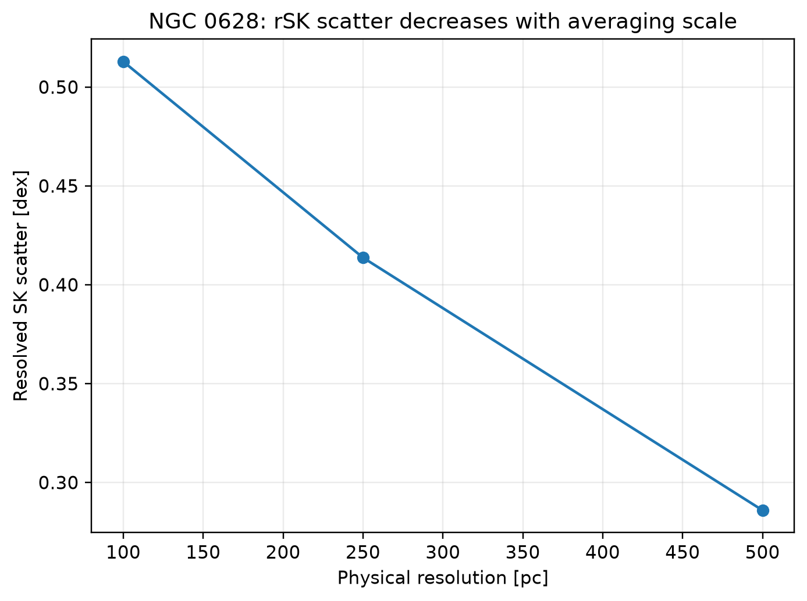
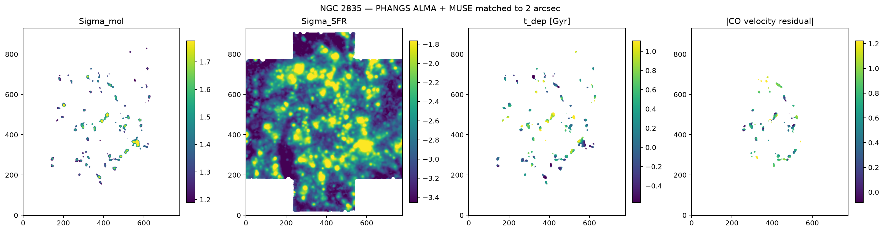
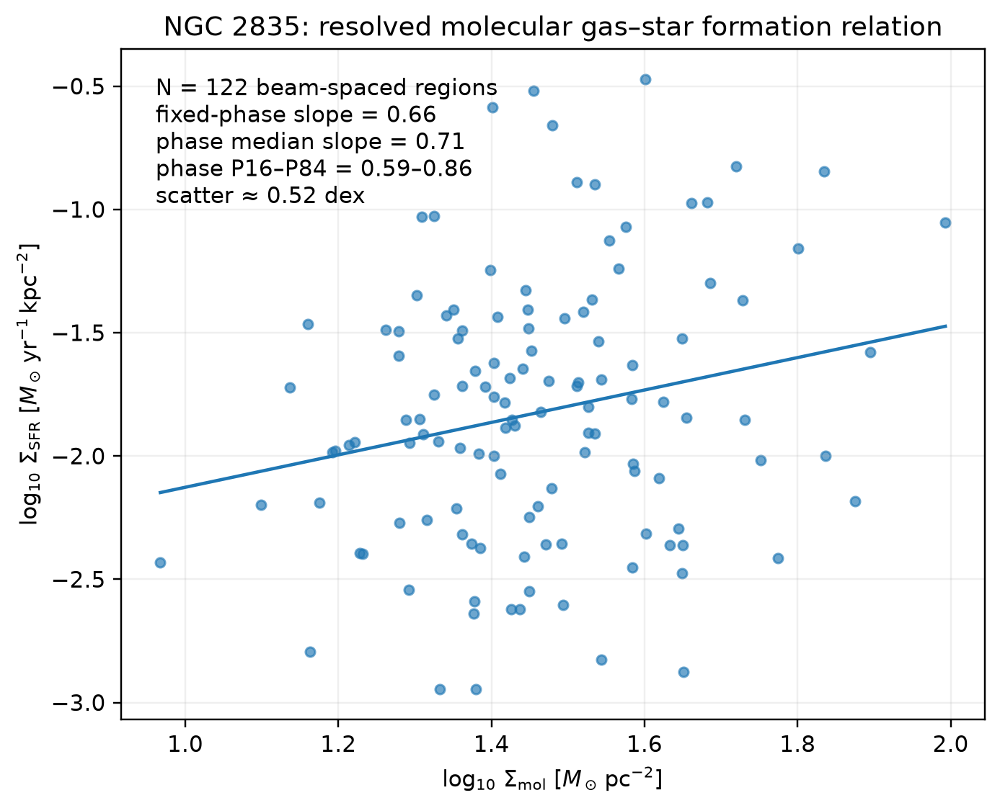
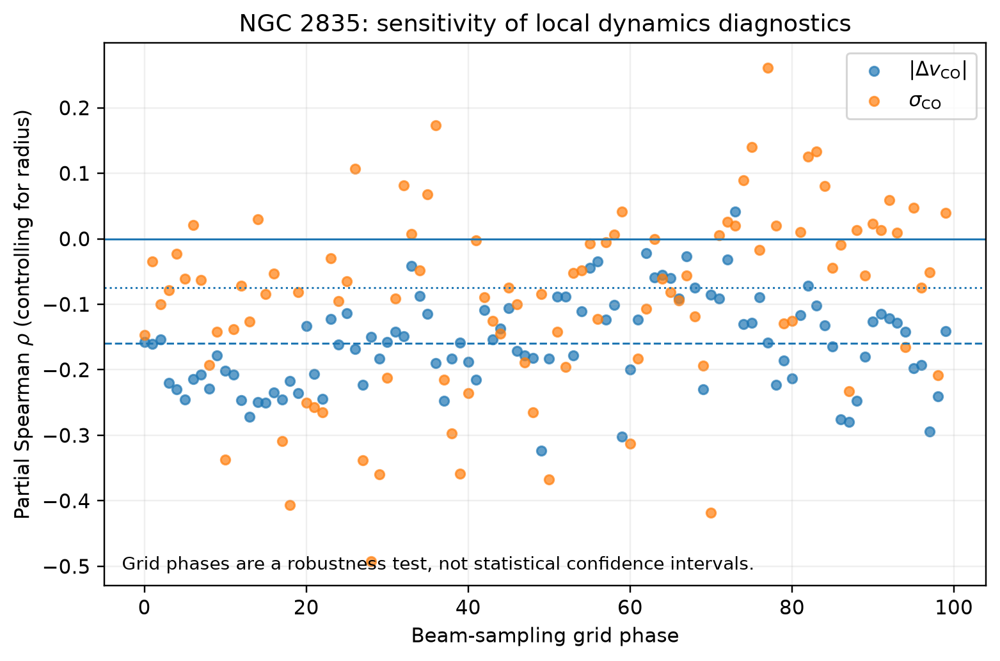

# Resolved ISM, Star-Formation Efficiency, and Dynamics

A compact public-data demonstrator connecting molecular gas, star formation,
and resolved galaxy dynamics using science-ready PHANGS products.

The project was designed as a reproducible test of a simple question:

> When does molecular gas fail to translate efficiently into star formation,
> and can local galaxy dynamics help explain the residual variation?

The emphasis is on careful multi-wavelength matching rather than on claiming
a new astrophysical detection from two galaxies.

## What the pipeline does

The analysis combines public PHANGS-ALMA CO(2-1) products with public
PHANGS-MUSE emission-line products.

It:

- PSF-matches MUSE and ALMA products before resolved comparison.
- Reprojects surface-brightness quantities onto a common WCS.
- derives Balmer-decrement-corrected H-alpha star-formation-rate surface density.
- converts CO(2-1) intensity to molecular-gas surface density using an explicitly
  recorded baseline conversion.
- constructs approximately beam-independent resolved samples.
- measures the resolved molecular Schmidt-Kennicutt relation and depletion time.
- incorporates published PHANGS CO rotation curves.
- tests local CO linewidth and non-circular velocity diagnostics.
- audits sensitivity to the arbitrary phase of the beam-sampling grid.

Only public science-ready products are used. Raw ALMA visibilities and raw MUSE
datacubes are not required.

## NGC 0628: physical-scale validation

NGC 0628 is used as a validation target rather than as the principal dynamics
target because its nearly face-on orientation makes detailed projected
kinematics less constraining.

Across the scales with sufficient independent measurements, the resolved
molecular-gas/SFR scatter decreases as the maps are averaged from roughly
100 pc toward 500 pc.

The 1-kpc experiment is retained as an explicit insufficient-sample result
rather than forcing a regression from only three approximately independent
measurements.

## NGC 2835: molecular gas, SFR, and dynamics

NGC 2835 provides a moderately inclined test case.

The ALMA and MUSE products are matched to a common 2-arcsec PSF, corresponding
to approximately 118 pc at the adopted distance.

The analysis yields 122 beam-spaced CO-detected regions. The pixel-level
molecular depletion-time distribution has a median of approximately 1.8 Gyr.

### Resolved molecular star-formation relation

The resolved relation has substantial cloud-scale scatter.

The exact fitted slope is sensitive to the phase used to place the
approximately independent beam-sampling grid. Across all 100 grid phases the
median slope is about 0.71, while the resolved scatter remains much more stable
at about 0.52 dex.

For that reason the slope is treated as a diagnostic measurement rather than
as evidence for a precise sub-linear star-formation law.

### Dynamics pilot

The published PHANGS CO rotation curve is used to construct a circular
velocity model and orbital quantities.

Two genuinely local gas-kinematic diagnostics are then tested against
star-formation residuals:

1. CO velocity linewidth.
2. absolute CO velocity residual relative to the circular model.

The analysis refits the resolved gas-SFR relation on the exact subset used by
each dynamical diagnostic and controls for galactocentric radius.

The linewidth result is consistent with no robust residual relation.

The non-circular velocity diagnostic is mostly weakly negative across
beam-sampling phases, but the phase distribution is a robustness experiment,
not a statistical confidence interval. It is therefore reported only as a
suggestive pilot result and not as a detection.

## Scientific guardrails

This repository is intentionally conservative.

The current analysis does **not** claim:

- raw ALMA or MUSE reduction expertise from these public products;
- a statistically significant dynamical regulation detection;
- a universal resolved star-formation-law slope;
- a complete treatment of DIG contamination;
- a metallicity-dependent CO-to-H2 conversion;
- a beam-smearing-corrected molecular velocity dispersion.

Those are natural extensions of the framework, not assumptions hidden inside
the present result.

## Data provenance

Public products are drawn from:

- PHANGS-ALMA, Leroy et al. 2021, ApJS 257, 43,
  DOI 10.3847/1538-4365/ac17f3.
- PHANGS-MUSE, Emsellem et al. 2022, A&A 659, A191,
  DOI 10.1051/0004-6361/202141727.
- PHANGS CO kinematics and rotation curves, Lang et al. 2020, ApJ 897, 122,
  DOI 10.3847/1538-4357/ab9953.

Large FITS products are deliberately excluded from version control.

## Reproducibility

The repository separates:

- data discovery/download,
- physical map construction,
- resolved-regression analysis,
- sampling-phase robustness tests,
- presentation figures.

The test suite and Ruff checks should both pass before a release is tagged.

## Reproducing the public-data inputs

The exact science-ready PHANGS products used by the demonstrator are listed in
`config/public_data_products.tsv`.

The repository deliberately does not contain the large FITS products themselves.
NGC 2835 acquisition utilities are retained under `preflight/ngc2835/`.
The NGC 0628 products are listed explicitly in the manifest rather than retaining
the exploratory archive-discovery scripts used during development.

The science analysis starts from these public high-level products; this repository
does not claim calibration or reduction of the underlying raw ALMA visibilities or
MUSE exposures.
